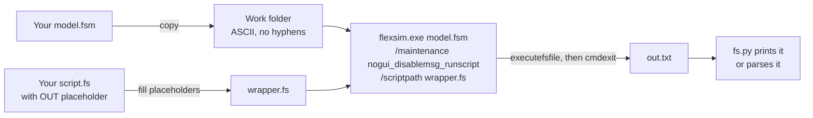
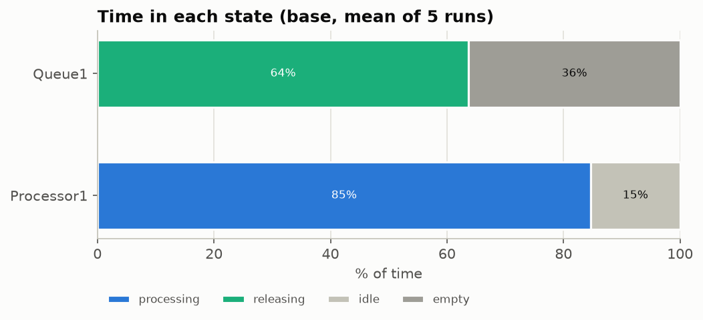
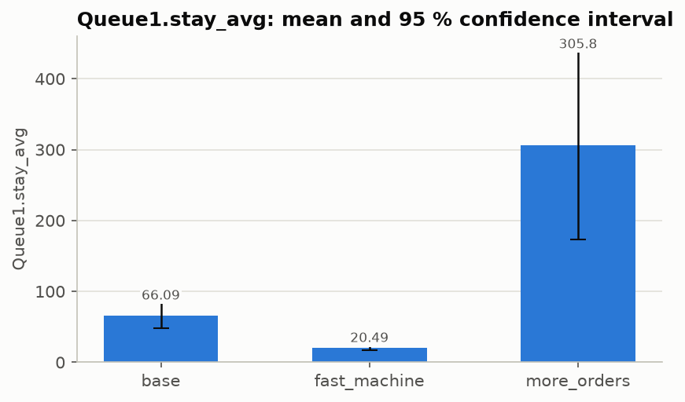
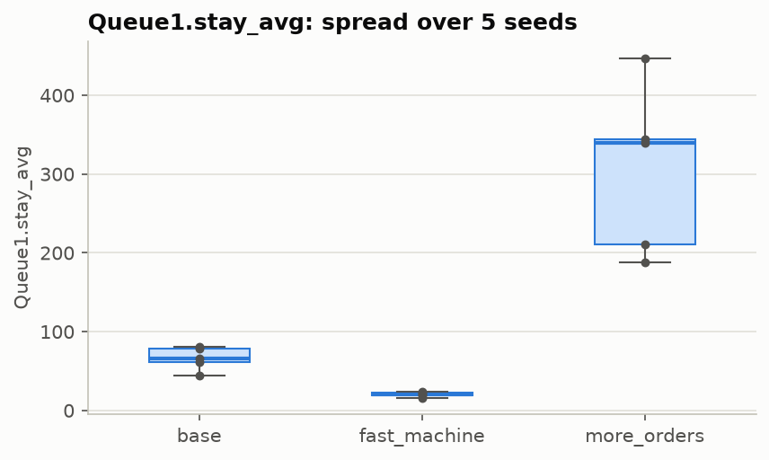
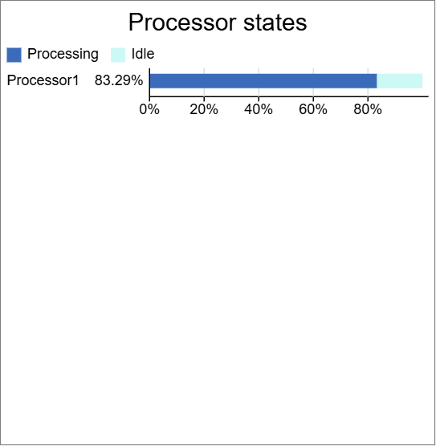

# FlexSim Claude Toolkit

**Let Claude Code read, run and test your Autodesk FlexSim models — with no FlexSim window.**

FlexSim is a GUI tool. Checking a model, running 20 replications or comparing three scenarios normally means a lot
of clicking. This toolkit gives [Claude Code](https://claude.com/claude-code) four skills that do it from the
command line:

| Skill | What it does |
|---|---|
| [`flexsim`](skills/flexsim/SKILL.md) | Summarize a model, dump any tree node, run it and get stats per object, run seeded replications in parallel, build a model by script, look up FlexScript commands |
| [`flexsim-experiment`](skills/flexsim-experiment/SKILL.md) | Scenarios x seeds, in parallel → `runs.csv`, `summary.csv` (mean, sd, 95 % CI) and `results.xlsx` |
| [`flexsim-charts`](skills/flexsim-charts/SKILL.md) | PNG charts from the results (state bars, CI bars, box plots), and FlexSim's own dashboard charts to PNG |
| [`flexsim-bisect`](skills/flexsim-bisect/SKILL.md) | Find the line of a FlexScript file that does not compile — FlexSim itself gives no error text |

You can also use the Python scripts alone, without Claude.

## How the no-GUI runner works

FlexSim has a maintenance mode that opens a model, runs a FlexScript file and stays silent. The runner wraps it:



1. `fs.py` copies the model to a work folder. Your model file is never written.
2. It fills `{{OUT}}`, `{{WORK}}`, `{{SEED}}`, `{{HOURS}}` in your script.
3. It starts FlexSim with no window. A small wrapper runs your script with `executefsfile()`, writes a status line
   and closes FlexSim, so your script needs no `cmdexit()`.
4. Your script writes what you want to know to `{{OUT}}`; `fs.py` prints it.
5. On a timeout it closes only the FlexSim process it started. Your own FlexSim windows stay open.

For replications and experiments, several FlexSim processes run at the same time, each in its own work folder.

### Traps this runner handles for you

These cost hours to find. The runner and the skill notes deal with them:

- **FlexSim cuts `/scriptpath` at the first hyphen.** The work folder has no hyphens or spaces.
- **Git Bash rewrites `/maintenance` into a file path**, and FlexSim then ignores the script. The runner starts
  FlexSim from Python `subprocess`.
- **A script with a compile error is skipped with no message.** The wrapper reports "no output", and
  `flexsim-bisect` finds the line.
- **`library().find("?Sink")` gives you a Process Flow activity**, not the 3D Sink. Use `fixedresources/Sink`.
- **Model time units differ.** Hours are converted to model time with
  `convert(getmodelunit(START_TIME) + h * 3600, FS_DATETIME, MODEL_TIME)`, so `--hours 8` means 8 hours in any model.

## Quick start

Needs Windows, FlexSim (tested with FlexSim 2027, Education licence), Python 3.10+, and
[uv](https://docs.astral.sh/uv/) for the charts.

```powershell
git clone https://github.com/MochoPlayer/flexsim-claude-toolkit
cd flexsim-claude-toolkit
.\install.ps1                      # copies the 4 skills to ~/.claude/skills
python -I -X utf8 tests/run_tests.py
```

Then ask Claude: *"What does examples/demo.fsm do?"* or *"Compare the scenarios in examples/scenarios.json with 10 seeds."*

Optional settings (environment variables): `FLEXSIM_EXE` (path to flexsim.exe; default: the newest one under
Program Files), `FLEXSIM_WORK` (work folder), `FLEXSIM_JOBS` (parallel runs, default 6).

## Examples

All examples use the demo model in [`examples/`](examples): Source → Queue → Processor → Sink, arrivals every
30 s on average (exponential), 25 s processing. It is built by a script: [`examples/build_demo.fs`](examples/build_demo.fs).

### `flexsim`: what is in this model?

```
> python -I -X utf8 skills/flexsim/fs.py summary examples/demo.fsm
# UNITS time=second length=meter

## Source1 (Source) at x=0.00 y=0.00 size=1.06x1.06
  in: | out: 1=Queue1 | center:
  code interarrivaltime:
    return exponential(0, 30, 1);
## Processor1 (Processor) at x=8.00 y=0.00 size=4.00x3.00
  in: 1=Queue1 | out: 1=Sink1 | center:
  labels: Shift=1.0000
  changed vars: cycletime=25.0000
...
```

It prints only what differs from a fresh object of the same class, so changed settings and custom code stand out.

### `flexsim`: run it for 8 hours

```
> python -I -X utf8 skills/flexsim/fs.py sim examples/demo.fsm 8
# time unit: second  stop=28800
REP1  Queue1      Queue      in=963  out=962  stay_avg=54.93  content_avg=1.835  content_max=11  empty=10975.8  releasing=17806.5
REP1  Processor1  Processor  in=962  out=961  stay_avg=25.00  content_avg=0.835  idle=4764.5  processing=24025.0
REP1  Sink1       Sink       in=961  out=0
END rep1 t=28800.0
```

`fs.py reps examples/demo.fsm --seeds 1-20 --hours 8` runs 20 seeded replications, 6 at a time.

### `flexsim-experiment`: what if the machine were faster?

[`examples/scenarios.json`](examples/scenarios.json) has three scenarios: `base`, `fast_machine` (cycle time 20 s)
and `more_orders` (arrivals every 26 s).

```
> python -I -X utf8 skills/flexsim-experiment/experiment.py examples/demo.fsm examples/scenarios.json --out results
3 scenarios x 5 seeds = 15 runs, 8 h each; 0 done already; 6 at the same time
  base_1: done [6 s]
  ...
15/15 runs in 25 s -> results (runs.csv, summary.csv, results.xlsx)
```

| scenario | Queue1 mean wait (s) | 95 % CI | Processor busy |
|---|---|---|---|
| base | 66.1 | ± 18.1 | 84.7 % |
| fast_machine | 20.5 | ± 3.7 | 67.8 % |
| more_orders | 305.8 | ± 132.8 | 96.2 % |

All scenarios use the same seeds, so the differences come from the change, not from luck.

### `flexsim-charts`: see it

```
uv run --with matplotlib python -I -X utf8 skills/flexsim-charts/charts.py results --out charts --metric Queue1.stay_avg --objects Queue1,Processor1
```

| | |
|---|---|
|  |  |
|  |  |

The last one is FlexSim's own dashboard chart, exported by `dashboard_png.py`: it builds the charts on one
dashboard, runs the model once and captures each chart with Win32 `PrintWindow`, even when FlexSim is behind other windows.

### `flexsim-bisect`: which line is wrong?

[`examples/broken.fs`](examples/broken.fs) has one common mistake. FlexSim runs none of it and says nothing.

```
> python -I -X utf8 skills/flexsim-bisect/bisect.py examples/demo.fsm examples/broken.fs
9 top-level statements; about 5 FlexSim runs
  ok up to line 11, fails by line 15
  ok up to line 11, fails by line 13
  ok up to line 12, fails by line 13
first failing statement: lines 13-13
    fpt("queue at x=" + string.fromNum(Model.find("Queue1").location.x)); fpr();
```

`Model.find()` returns a `treenode`; `.location` needs a cast to `Object` first.

## Tests

`tests/run_tests.py` runs every tool for real against FlexSim and the demo model (13 checks, about 3 minutes):
build the model by script, summary, dump, sim (processor busy about 83 % = 25/30), parallel reps (different per
seed, identical for the same seed), bisect (finds line 13; passes a good script), experiment (the faster machine
cuts the queue time; the Excel file opens; a bad scenario is reported), charts, dashboard PNGs, command lookup.
`--skip-dashboard` skips the one test that opens a FlexSim window.

## Repository layout

```
skills/flexsim/              runner (fs.py), command lookup (cmdref.py), FlexScript scripts (summary, dump, sim, rep)
skills/flexsim-experiment/   experiment.py
skills/flexsim-charts/       charts.py, dashboard_png.py, charts_example.fs
skills/flexsim-bisect/       bisect.py
examples/                    demo.fsm, build_demo.fs, scenarios.json, broken.fs
tests/                       run_tests.py, check_xlsx.py
```

The three extra skills import `../flexsim/fs.py`, so install them side by side (`install.ps1` does).

## License

MIT — see [LICENSE](LICENSE). FlexSim is a product of Autodesk; this project is not affiliated with Autodesk.
